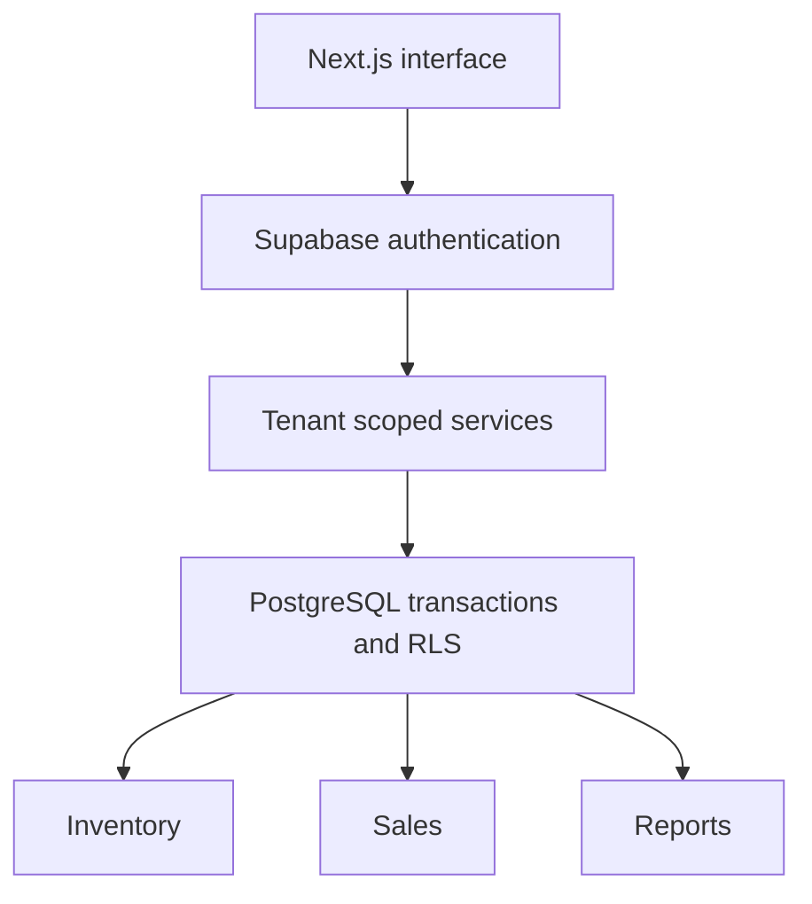
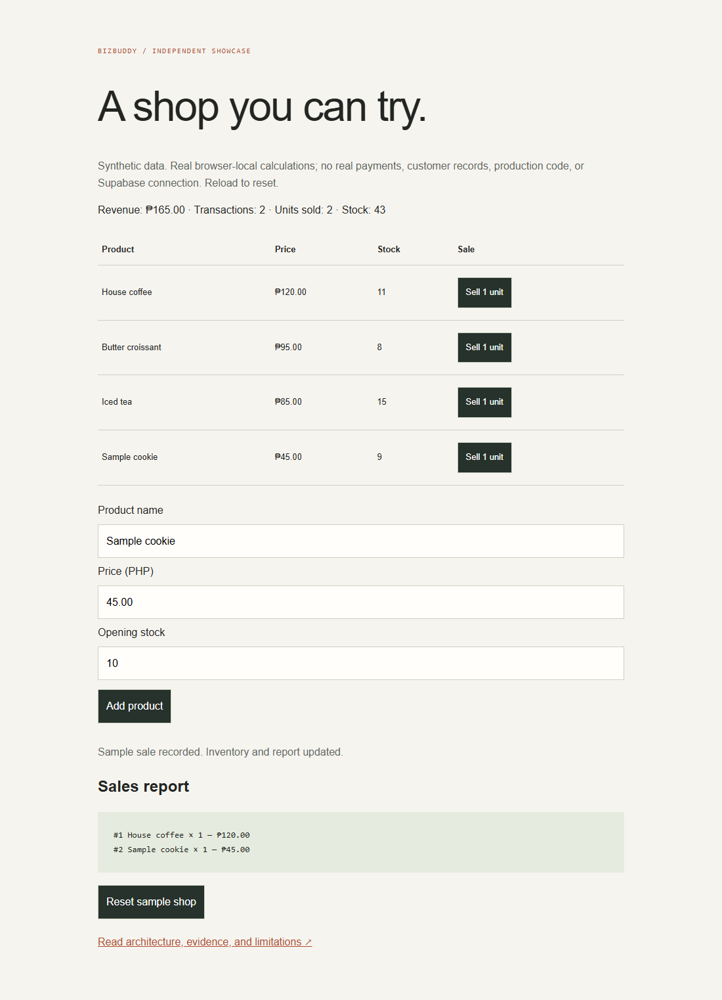

# BizBuddy

A technical showcase of the original POS and business platform, with an independently authored synthetic browser sandbox.

No real payments, production data, auth, database persistence, tax, refunds or multi-user concurrency. No proprietary source or original history is included.

## Original architecture

This diagram summarizes inspected original source. The public demo is smaller and separate. See [source audit](docs/AUDIT.md) for stack versions, feature status, source references and verification limits. ASTRA uses React/Vite + Node/SQLite; BizBuddy uses Next.js with Supabase integration code and Vercel configuration. No hosted deployment is asserted.

## Public sample status

- VERIFIED: five domain tests pass with `npm test`.
- IMPLEMENTED: browser UI and synthetic sample data.
- Live original integration: not verified in this showcase.

## Setup and demo

Node.js 24 is recommended. No package installation or secrets are needed for tests. Run `npm test`. To serve the browser demo, from this directory run `python -m http.server 3201 --bind 127.0.0.1` (Python 3) and open http://127.0.0.1:3201/. Direct file URLs cannot reliably load ES modules.

Add a synthetic product, sell one unit, inspect stock and revenue/receipt updates, then reset. Prices use integer PHP centavos.

## Repository contents

- index.html, app.mjs, style.css: isolated demo UI
- src/demo.mjs: independently authored domain model
- tests/demo.test.mjs: meaningful validation and state tests
- docs/AUDIT.md: original feature evidence and limitations
- docs/screenshots/demo.png: public synthetic demo capture
- LICENSE.md: retained ownership; no private-source license implied

## Screenshot

Captured from this standalone synthetic sample; not a production screenshot.

## Verification and limitations

Six selected original suites passed 133 checks in an isolated private copy. Database checks used PGlite, not a hosted Supabase project. Public browser controls were checked separately; see the portfolio verification report. No live endpoint, performance metric, customer or deployment is invented.

## Roadmap

Owner-approved publication; richer sanitized evidence after privacy/licensing review; deeper integration acceptance against explicitly authorized environments. Original implementation remains private.

## License and provenance

New sample code and diagrams were created for this showcase. No original product source, third-party media, secrets or Git history copied. All rights reserved pending owner selection of a public license. Public visibility does not itself grant redistribution rights.

## Actual application interface
Reviewed desktop and responsive phone captures from an isolated original runtime, using synthetic data, are in [docs/actual-ui](docs/actual-ui/). [Watch the narrated walkthrough](docs/actual-ui/walkthrough.mp4). The interactive sample in this repository remains an independent labelled demonstration. Video: local HyperFrames composition with the two explicitly approved ElevenLabs River narrations; no native mobile app or live provider claim.

